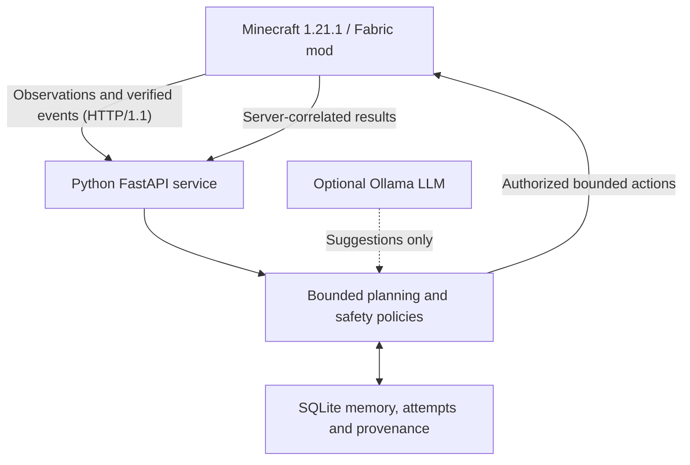

# MineLife AI — Engineering Case Study

> **Autonomous agent research prototype | Python 3.11 · Java 21 · Fabric 1.21.1 · FastAPI · SQLite · optional Ollama**

**The problem.** How can an AI agent pursue long-running goals in a changing game world without confusing intended actions, model-generated narratives or partial observations with actual progress?

**The approach.** MineLife AI uses a Java/Fabric mod for game observations and native actions, and a Python service for planning, persistent state and verified outcomes. The optional local LLM can propose bounded goals but **cannot issue unrestricted game commands or certify success**.

## Architecture at a glance



## Engineering decisions worth examining

| Challenge | Implementation |
| --- | --- |
| A long-running agent may claim success prematurely | Record commands and outcomes separately; link changes to server-correlated evidence |
| Models can suggest unsafe or impossible actions | Keep action authorization in deterministic policy and observed game capabilities |
| Session changes can invalidate pending work | Bound queues, timeouts and cooldowns; reject stale work using session/world/epoch checks |
| The process can be interrupted | Persist goals and durable memory in SQLite; use additive migrations and backups |
| AI experimentation must be reproducible | Python contract tests, Java verification checks and optional local LLM provider |

## Evidence and current limits

The [project status](../STATUS.md) records **319 Python tests**, a **successful Fabric build** and **535 Java policy/geometry assertions** during the November 1, 2026 validation. These are results of that documented validation, not proof that every future change will pass.

[GitHub Actions](../.github/workflows/ci.yml) adds repeatable Python 3.11 unit tests and Java 21/Fabric build checks on pull requests. **Check the CI run status before treating any build as verified.**

**Not yet demonstrated for the current revision:** sustained autonomous survival in a real Minecraft session, live Ollama latency/performance, social MCA integration, and reliable multi-day operation. Mocked/contract tests are **not** gameplay evidence. The agent does not claim consciousness.

## Reproduce the checks

With Python 3.11 and Java 21 installed:

```bash
python -m pip install -r requirements.txt
python -m unittest discover -s tests -v
cd mod
./gradlew build --no-daemon --console=plain
```

For Windows, use `mod/gradlew.bat build`. A full game session requires Minecraft Java 1.21.1, a compatible Fabric installation and the repository's [setup and safety instructions](../README.md); do not skip backup, explicit F8 authorization and local-only configuration.

## What this project demonstrates

It is a systems-engineering experiment in **agent orchestration, state consistency, constrained execution, API integration, testing and failure-aware autonomy**. The engineering value is in the boundaries between inference, action and verification—not in claiming that a simulated character is independently intelligent.

**Maintainer:** Diogo Abreu da Silva — Electronics Engineering undergraduate, Federal University of Itajubá (UNIFEI), Brazil. AI-assisted development and review are documented in the repository; test and gameplay claims are kept separate.
